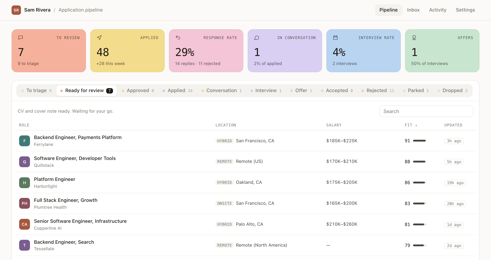

<p align="center"><picture><source media="(prefers-color-scheme: dark)" srcset="docs/assets/wordmark-dark.svg"></picture></p>

<p align="center">A job search pipeline that Claude Code or Codex runs for you. You approve every application.</p>

<p align="center">
I built this for my own job search: about 260&nbsp;applications in 12&nbsp;days,<br>
which ended in one offer that I accepted. This is the cleaned-up version, rebuilt so anyone can use it.
</p>

<p align="center">
  
</p>

<p align="center"><sub>The demo: a fictional engineer searching in San Francisco. Every company is invented.</sub></p>

It finds jobs that match your rules, writes a CV for each one from facts you've confirmed, fills in the application once you approve it, and reads your inbox to see who replied. It never submits an application you haven't approved.

## Try it

```bash
git clone https://github.com/JoschuaSuenneke/job-pipeline && cd job-pipeline && bun install
bun src/cli/index.ts demo
```

This opens the dashboard with a fictional pipeline in a few seconds, no setup needed. `demo erika` shows a search in Germany instead.

## Use it for your own search

```bash
bun src/cli/index.ts init              # targets, commute, pay, rules, your agent
bun src/cli/index.ts import-cv cv.pdf
cd ~/.job-pipeline && claude           # or codex
> onboard me
```

After onboarding, you ask for things in plain language:

```
> scout and triage
> tailor the best five
> go for 1 and 3
> check my inbox
```

You need [Bun](https://bun.sh) and [Claude Code](https://claude.com/claude-code) or [Codex](https://github.com/openai/codex). No API key.

## How it works

Claude Code or Codex does the reading and writing. job-pipeline gives it the tools, keeps the records, and enforces your rules.

| Your agent | job-pipeline |
|---|---|
| reads each posting in full and decides whether it fits | pulls jobs from 8 ATS systems (Greenhouse, Lever, Ashby…), 5 remote boards and the German job agency |
| asks you about your experience and writes it down as facts | stores each fact and uses it only after you confirm it |
| writes a CV and cover note for each job | picks the bullets that fit and checks every number, tool and employer against your facts |
| fills in the application form | allows the submit only after your approval, once per job |
| tells you who replied | syncs IMAP, Gmail or Outlook and updates the status of each job |

Everything runs on your machine. Your data lives in `~/.job-pipeline`, never in this repo.

## Rules enforced in code

An agent can ignore an instruction in a prompt, so these rules are checked by the MCP server instead:

- An application goes out only after you approve that job. The approval stores your own words and works once.
- Every number, tool and employer in a CV or cover note has to match a fact you confirmed.
- One application per company, no companies from your blocklist, and a daily limit.
- The agent ticks a consent box only if you allowed that kind of consent, and never when the statement is false.
- It never sends email. At most it puts a draft in your Drafts folder for you to send.

## Configure it for your search

Roles, seniority, years of experience, commute tiers ("San Francisco daily, Palo Alto for 2 office days"), remote regions, pay floor and currency, work authorization, blocklist, consents and mailbox are all set in one config file. It works from the US, the UK and the EU: remote roles are matched to the regions you can work from, and pay is compared only in your currency.

There are two complete examples: [`examples/sam`](examples/sam) (San Francisco) and [`examples/erika`](examples/erika) (Germany). See also [mail setup](docs/mail-setup.md) and [architecture](docs/architecture.md).

## Design choices

It's built to send fewer applications that fit well, not as many as possible. Jobs come only from official sources: public APIs and company career pages. Your data stays on your machine.

## Similar projects

[career-ops](https://github.com/career-ops-hq/career-ops)

[MIT](LICENSE) · [Contributing](CONTRIBUTING.md) · [Security](SECURITY.md)
